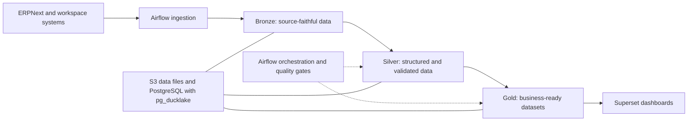

# Openflow

**An opinionated, self-hostable enterprise suite built around openDesk.**

Openflow brings collaboration, business operations, community discussions, data pipelines, and business intelligence into a coherent distribution. The goal is a practical open-source alternative to common commercial enterprise suites, with useful defaults and repeatable upgrades.

**Status: requirements and architecture.** The integration stack, process packages, and installation workflow described here are planned. There is no supported Openflow release or complete installation command yet.

## Start here

- [Product and technical requirements](REQUIREMENTS.md): scope, architecture, initial processes, and acceptance criteria.
- [Contribute](CONTRIBUTING.md): a starting point for people and coding agents.
- [Agent instructions](AGENTS.md): repository rules and validation expectations.
- [Roadmap](docs/roadmap.md): the sequence from requirements to a tested distribution.
- [Upstream integration map](docs/upstream-integration.md): where existing openDesk adaptations live.

The project is hosted in the [openflow-workspace organization](https://github.com/openflow-workspace). The main repository is [`distribution`](https://github.com/openflow-workspace/distribution).

## The suite

| Component | Responsibility |
|---|---|
| openDesk | Collaboration workspace, files, communication, and project work |
| Nubus / Keycloak | Shared identity and portal integration, building on the selected openDesk release |
| Discourse | Discussions and community knowledge |
| ERPNext / Frappe | Business operations such as customers, sales, purchasing, inventory, and invoicing |
| Apache Airflow | Scheduled ingestion, transformation, quality checks, and publication |
| S3-compatible storage | Raw extracts and lakehouse data files |
| PostgreSQL + pg_ducklake | Lakehouse catalog/query integration and analytical access |
| Apache Superset | Preconfigured datasets, metrics, charts, and dashboards |

Modules should be independently selectable. Business objects have defined systems of record; integrations link them without introducing unrestricted bidirectional synchronization.

## From operational data to useful answers

A standard process package should deliver the whole path: source extraction, Bronze/Silver/Gold models, quality checks, documented metrics, sample data, and ready-to-import Superset assets. Initial candidates include sales and receivables, purchasing and inventory, and project delivery.

The shared data platform has its own access rules. Logging in through Keycloak does not automatically grant access to ERP records or analytical datasets.

## How the downstream stays maintainable

Openflow owns the configuration, adapters, process packages, and necessary patches. Releases will pin a compatible openDesk baseline, component sources, chart versions, and image digests. Update PRs must rebuild affected components and validate integrations before a new release is published.

Prefer supported configuration and extension mechanisms. Fork individual components only when necessary. The local collection of upstream repositories is a research workspace, not a collection to copy into this repository or a tested release manifest.

ERPNext is a candidate for replacing selected SAP workflows. Actual replacement requires mapping the existing processes, integrations, and migration requirements; it is not a blanket promise of SAP feature parity.

## Contributing

Start with [CONTRIBUTING.md](CONTRIBUTING.md). Documentation, process definitions, sample data, connector contracts, quality rules, and compatibility investigations are useful contributions at this stage. PRs created with coding agents are welcome when reviewed and validated by the contributor.

All Openflow-owned project content is authored in English. Third-party source code and attribution retain their original form. Openflow is an independent downstream project and does not claim endorsement by its upstream projects.
