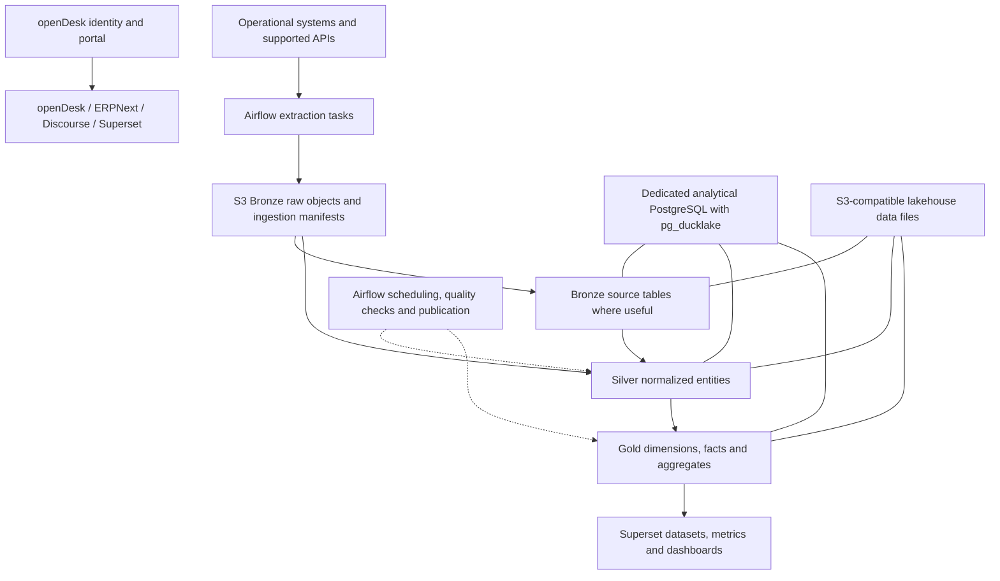

# Openflow requirements

Status: initial requirements baseline; implementation pending.

Organization: `openflow-workspace` on GitHub. Main repository: `distribution`.

This document records agreed product direction and proposed acceptance criteria. MUST denotes a requirement for the applicable milestone; SHOULD denotes a preferred approach. Inclusion here does not imply a feature has been implemented or tested.

## 1. Product intent

Openflow is an opinionated, modular, self-hostable enterprise suite built around openDesk. It combines a collaboration workspace, discussion platform, ERP, data orchestration, lakehouse, and BI. It SHOULD provide a useful first configuration for common business processes rather than requiring every adopter to assemble connectors, data models, and dashboards from scratch.

The product is intended as an open-source alternative to common paid enterprise systems. A specific SAP replacement requires a process and migration assessment; broad feature parity is not a release criterion.

## 2. Scope and ownership

| ID | Requirement |
|---|---|
| OF-001 | Use a pinned openDesk release as the collaboration baseline and preserve a repeatable path for upstream updates. |
| OF-002 | Include independently selectable modules for Discourse, ERPNext/Frappe, Superset, Airflow, and the lakehouse. |
| OF-003 | Provide shared login and portal navigation through the openDesk identity/portal stack, with explicit application role mappings and account lifecycle rules. |
| OF-004 | Keep Openflow-owned configuration, extensions, process packages, and patches separate from upstream source. |
| OF-005 | Author all Openflow-owned repository content and contribution materials in English. Preserve upstream identifiers, licenses, attribution, and third-party content. |
| OF-006 | Publish requirements, contribution instructions, compatibility information, release notes, and upgrade instructions under `openflow-workspace`. |

Openflow-owned files belong in this repository or dedicated integration repositories when independently releasable. Upstream applications remain upstream dependencies. Secrets, private company data, and environment-specific configuration MUST NOT be published with the distribution.

## 3. Target architecture

This is a logical architecture, not a claim about existing SQL schemas or deployment resources. Airflow orchestrates work; tasks execute extraction and transformation code. The lakehouse is separate from operational application databases.

### Storage and query roles

| ID | Requirement |
|---|---|
| DATA-001 | Use S3-compatible object storage for source-faithful raw extracts, manifests, and lakehouse data files. |
| DATA-002 | Use PostgreSQL with the `pg_ducklake` extension as the intended lakehouse integration and analytical SQL interface. |
| DATA-003 | Treat DuckLake catalog metadata and Parquet data files as distinct but coordinated state. Define which PostgreSQL database/schema owns catalog and control metadata. |
| DATA-004 | Connect Superset to validated Gold datasets through a tested analytical endpoint. The intended default is PostgreSQL access backed by pg_ducklake. |
| DATA-005 | Pin and validate PostgreSQL, pg_ducklake, DuckDB/DuckLake dependencies, object storage behavior, and Superset driver compatibility as a release combination. |

`pg_ducklake`, a PostgreSQL extension, is distinct from DuckDB's `ducklake` extension with a PostgreSQL catalog. They MUST NOT be silently treated as interchangeable. The exact extension version, SQL interface, S3 credential mechanism, data inlining behavior, authorization behavior, and supported platforms remain compatibility validation items. No floating development version is a production baseline.

Airflow's metadata database, Superset's metadata database, application databases, and the analytical lakehouse MUST have separate database identities and ownership. Whether to share a PostgreSQL server in a small deployment is a later deployment decision, not permission to mix their schemas and credentials.

## 4. Medallion data lifecycle

| Layer | Purpose | Required output |
|---|---|---|
| Bronze | Retain source-faithful data for audit and replay. | Raw extracts plus extraction metadata; optional queryable source tables. |
| Silver | Add reliable structure and consistent entities. | Typed, normalized, deduplicated records; stable source keys; validation results and rejected records. |
| Gold | Prepare data for defined business questions. | Curated facts, dimensions, aggregates, metric definitions, and access contracts. |

### Bronze requirements

- **BR-001:** Record source system/instance, tenant or company where applicable, source object ID, extraction interval, ingestion timestamp, schema version, run ID, and checkpoint information.
- **BR-002:** Preserve source payloads as captured within an explicit retention policy. Raw retention is not an indefinite-storage requirement; deletion obligations and sensitive-field exclusions apply.
- **BR-003:** Detect pagination completion, source updates, and deletions/tombstones where the connector supports them. Document snapshot-only limitations.
- **BR-004:** Advance the successful extraction checkpoint only after output and its manifest are durably published. Partial runs MUST be distinguishable from complete runs.

### Silver requirements

- **SI-001:** Normalize types, timestamps/time zones, keys, enumerations, and source-specific structures through versioned transformations.
- **SI-002:** Deduplicate using source identity and a documented revision/ordering rule. Keep identifiers distinct across source instances and companies.
- **SI-003:** Validate required fields, uniqueness, referential integrity, and supported schema changes. Quarantine invalid data with actionable reasons.
- **SI-004:** Preserve original monetary amounts and currencies. Currency conversion, entity matching, and other enrichment require explicit reference data and documented rules.
- **SI-005:** Retain lineage from transformed records or partitions to source identity, input versions, transformation version, and execution run.

### Gold requirements

- **GO-001:** Each dataset MUST declare its grain, keys, measures, dimensions, aggregation rules, supported filters, ownership, and update schedule.
- **GO-002:** Metrics MUST define currency, time zone, reporting period, treatment of cancellations/returns/deletions, and any historical-state assumptions.
- **GO-003:** Publish only quality-approved output. When publication fails, keep the last successful output available and expose its freshness.
- **GO-004:** Prevent invalid aggregation across incompatible currencies, companies, or dataset grains. Approval of a dashboard does not authorize joining arbitrary sensitive data.

## 5. Apache Airflow

| ID | Requirement |
|---|---|
| AF-001 | Use Apache Airflow as the default orchestrator for extraction, transformation, checks, and Gold publication. |
| AF-002 | Ship versioned DAGs with explicit dependencies and configurable schedules, intervals, retries, timeouts, and source rate limits. |
| AF-003 | Make tasks retry-safe and replayable for a defined interval. Retries MUST NOT duplicate published business records or corrupt checkpoints. |
| AF-004 | Support initial loads, incremental runs, and controlled backfills. A backfill MUST NOT silently move the live incremental checkpoint backward. |
| AF-005 | Pass small metadata and storage references between tasks; store bulk data in object storage or the lakehouse rather than XCom. |
| AF-006 | Use managed secret references and runtime connections. Do not embed credentials in DAGs, SQL, example exports, or logs. |
| AF-007 | Expose failures, source/schema drift, extraction completeness, row counts, rejected records, run duration, and freshness. |
| AF-008 | Treat batch orchestration as the initial default. Any future CDC/streaming mechanism must integrate with explicit consistency and recovery rules. |

Transformation logic SHOULD be testable separately from scheduling. Small deployments SHOULD avoid requiring additional processing platforms unless measured requirements justify them.

## 6. Standard process packages

A process package is the unit that makes the distribution useful out of the box. Each package MUST contain or reference:

1. A supported source/version matrix and the least-privileged connection contract.
2. Extraction DAGs and checkpoint/replay behavior.
3. Bronze, Silver, and Gold schemas and transformations.
4. Data quality rules, representative synthetic fixtures, and expected results.
5. A metric dictionary and clear analytical assumptions.
6. Superset import assets for datasets, metrics, charts, and dashboards.
7. Configuration for source instances, company mapping, schedule, and access roles.
8. Install, upgrade, backfill, troubleshooting, and removal guidance.

The package layout is planned as `processes/<process-id>/` with `dags/`, `models/`, `quality/`, `superset/`, `fixtures/`, and an English README. No such package should be advertised as available before its end-to-end acceptance criteria pass.

### Initial package candidates

| ID | Process | Primary inputs | Initial analytical questions |
|---|---|---|---|
| PP-001 | Sales and receivables | ERPNext customers, orders, invoices, payments and their associations | What was invoiced, what remains outstanding, and how is overdue debt distributed? |
| PP-002 | Purchasing and inventory | ERPNext suppliers, purchase documents, receipts and stock movements | What is ordered, received, outstanding, and currently held in stock? |
| PP-003 | Project delivery | OpenProject projects/work packages and supported time data; explicit ERPNext project links | What is progressing, overdue, or blocked, and how does recorded effort compare with agreed plans? |
| PP-004 | Collaboration and community, optional | Explicitly approved application activity metadata | How are collaboration services being used at an aggregate level? |

PP-001 is the proposed first vertical slice. Metrics such as revenue recognition, inventory valuation, profit, or project margin MUST NOT be inferred from incomplete input data. Packages must either provide the required accounting/cost rules or clearly scope those metrics out. PP-004 excludes message/document contents and individual employee scoring by default.

## 7. Superset experience

- **BI-001:** Provide preconfigured dataset definitions, metrics, charts, and dashboards for each supported standard process package.
- **BI-002:** Import or upgrade assets reproducibly using stable identifiers and environment-specific database bindings. Repeated imports MUST NOT create duplicate assets.
- **BI-003:** Keep managed baseline assets distinguishable from local user-created dashboards. Define how upgrades preserve or intentionally migrate local customizations.
- **BI-004:** Display metric descriptions, source lineage at a useful level, and last successful data refresh. Stale data MUST be visible as stale.
- **BI-005:** Provide synthetic demo data with expected dashboard values, requiring no access to a real company's systems.
- **BI-006:** Separate viewer, analyst, operator, and administrator access. Validate company/tenant isolation through all exposed query paths, not only dashboard filters.

## 8. Identity, governance, and integration

- **IG-001:** Use the selected openDesk identity stack for shared sign-in where supported; define explicit provisioning, role assignment, session/logout behavior, and account disablement.
- **IG-002:** Application permissions MUST NOT be assumed to propagate to copied data. Define separate lakehouse grants, Superset permissions, and source-to-analytical access rules.
- **IG-003:** Prevent access across tenants/companies unless explicitly granted. Test extension-backed tables, views, SQL access, exports, caches, and object-store credentials against this requirement.
- **IG-004:** Keep Bronze access more restricted than approved Gold access. Use dedicated ingestion, transformation, maintenance, and BI identities with defined capabilities.
- **IG-005:** Define a system of record for customers, projects, tasks, and documents. Begin with stable identifiers and links; add narrowly scoped, idempotent APIs/events when needed.
- **IG-006:** Prefer a dedicated Frappe app for ERPNext integration and supported Discourse/Superset extension mechanisms over persistent core changes.

## 9. Downstream lifecycle and operation

- **OPS-001:** Record exact source revisions, image digests, chart versions, extension versions, and process-package versions in a release manifest.
- **OPS-002:** Automate candidate upstream updates as PRs, with compatibility and regression checks before release. Fetching new sources does not automatically approve an upgrade.
- **OPS-003:** Provide modular Kubernetes/Helm deployment, environment configuration, resource requirements, and a documented secret interface. An initial local evaluation profile may be added separately.
- **OPS-004:** Back up application data, Airflow/Superset metadata, lakehouse catalog, checkpoints, and object storage with coordinated restore procedures. Validate recovery from catalog/object-store mismatch scenarios.
- **OPS-005:** Define object lifecycle, snapshot expiration, file maintenance, and deletion policies. Never remove files still referenced by retained lakehouse snapshots.
- **OPS-006:** Document supported upgrade paths and migrations. A previous container image alone is not a database rollback plan.
- **OPS-007:** Publish source attribution and applicable component licenses with releases. A project-wide license selection does not replace upstream component obligations.

## 10. First vertical slice acceptance

The first implemented data milestone MUST demonstrate PP-001 from a synthetic ERPNext-compatible fixture through the complete stack:

1. A documented setup starts the selected Airflow, PostgreSQL/pg_ducklake, S3-compatible storage, and Superset versions.
2. Airflow ingests a defined interval into Bronze and records a complete extraction manifest.
3. Silver correctly normalizes and deduplicates customer, invoice, and payment data; malformed records are quarantined.
4. Gold reconciles to the fixture's expected invoice and outstanding-balance totals with documented currency and payment-allocation rules.
5. Superset imports the supplied assets and displays those expected results and refresh metadata.
6. Retrying the interval and importing the assets again leaves the same published business results and asset identities.
7. A failed extraction does not advance the checkpoint; a failed quality gate does not replace approved Gold output.
8. A controlled backfill recomputes the intended interval without corrupting current ingestion state.
9. Two synthetic companies demonstrate permitted access and denied cross-company access through every enabled BI/query path.
10. A documented backup/restore exercise recovers a consistent catalog, files, checkpoints, and BI configuration.

These are acceptance criteria to implement and run, not completed checks. Full suite readiness additionally requires the identity, application integration, deployment, and upgrade milestones in the roadmap.

## 11. Decisions still required

- Exact compatible release pins and CPU/platform support for all components.
- S3 implementation and deployment topology; retention and recovery objectives.
- pg_ducklake SQL behavior, access enforcement, catalog layout, and tested Superset connectivity.
- Connector scope, extraction strategy, deletion semantics, and historical-data availability per source version.
- Metric definitions and freshness targets for each process package.
- The specific SAP/business processes an adopter wants to replace and the migration scope.
- Project license for new Openflow-owned work and contributor licensing policy before accepting executable contributions.
- Public release cadence, supported upgrade window, and support commitments.

## References

- [openDesk deployment](https://gitlab.opencode.de/bmi/opendesk/deployment/opendesk)
- [ERPNext modules](https://frappe.io/erpnext/modules)
- [Frappe extension hooks](https://docs.frappe.io/framework/user/en/python-api/hooks)
- [Apache Airflow task and DAG best practices](https://airflow.apache.org/docs/apache-airflow/stable/best-practices.html)
- [pg_ducklake source and documentation](https://github.com/relytcloud/pg_ducklake)
- [DuckLake catalog and data format](https://github.com/duckdb/ducklake)
- [DuckLake PostgreSQL catalog documentation](https://ducklake.select/docs/stable/duckdb/usage/choosing_a_catalog_database)
- [Apache Superset](https://github.com/apache/superset)

References support technology descriptions. Openflow's architecture, requirements, and acceptance targets are project decisions and remain subject to implementation validation.
